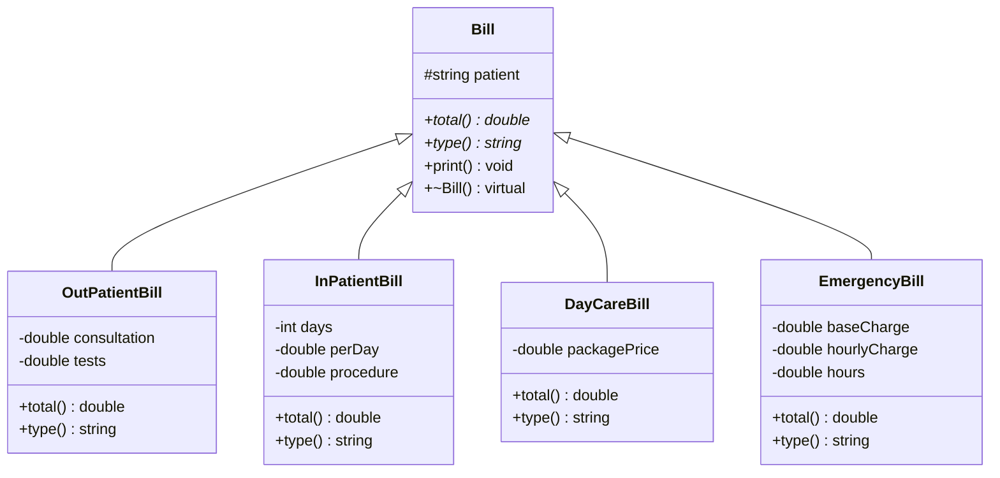

# Task A1 – Polymorphic Bill Hierarchy
## Common interface
Every bill stores a patient identifier/name and provides `total()`, `type()` and `print()`. `total()` and `type()` are pure virtual because their calculations and labels depend on the bill category. `print()` is a shared non-virtual operation that calls the virtual functions.

## UML

`*` denotes a pure virtual function. The destructor is virtual.

## Pseudocode – total all bills
```text
ALGORITHM CalculateDailyTotal(bills, count)
    dailyTotal ← 0
    FOR i ← 0 TO count - 1
        dailyTotal ← dailyTotal + bills[i].total()
    END FOR
    OUTPUT dailyTotal
END ALGORITHM
```
## Alternative: tagged structure and switch
A single structure stores a type tag and all possible fields. `total()` switches on the tag. Both approaches take O(n) time to total n bills. A tagged structure may reserve space for the largest field set in every bill; derived objects store only their own fields plus a vptr. Adding a type requires editing the switch, while polymorphism allows a new derived class without modifying the base interface or processing loop.
