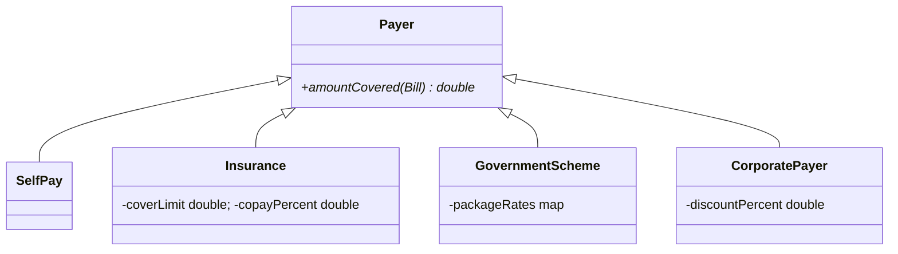

# Task A3 – Abstract Payer Classes
`Payer` is an abstract interface with `amountCovered(const Bill&)`. `SelfPay` pays the full bill. `Insurance` applies a cover limit and co-payment percentage. `GovernmentScheme` uses a fixed package rate based on the bill category.

A corporate payer is added as a new derived class implementing the same function. Existing payer classes and bill-processing code remain unchanged (Open/Closed Principle).

Example policy: insurance contribution = `min(bill.total(), coverLimit) * (1 - copayPercent/100)`. Validate percentages and limits.

## Alternative: function pointers / std::function
Store a callable policy and its required data (such as cover limit) in a policy object or lambda capture. Each invocation is O(1), like a virtual call. `std::function` may have storage/indirection overhead; a class stores state in named fields and gives a clearer interface. Both approaches keep payer-specific data with the policy.
